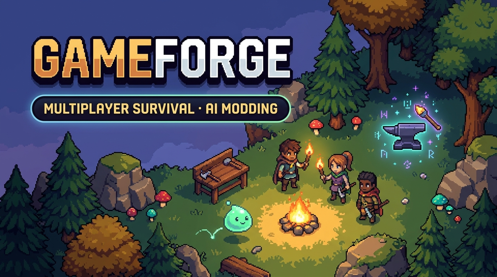

# Gameforge

> A collaborative multiplayer browser survival game & Claude-powered AI natural-language modding studio built with safety-by-design for young creators (ages 10–14).



---

## Overview

**Gameforge** combines a *Don't Starve*-inspired multiplayer pixel-art survival game with an AI-assisted modding loop designed specifically for kids aged 10–14 (Polish UI). Players explore, craft, and survive together in private group rooms, then fork the world onto a personal branch to invent new items, monsters, and rules using natural language or voice — with automated child-safety filtering and 7-day group voting before mods go live.

---

## Key Features

### Multiplayer Survival Gameplay
- **Real-Time Co-op World** — Powered by **Phaser 3** on the client and **Colyseus** on the authoritative game server.
- **Procedural World & Atmosphere** — Infinite procedural world with fog of war, an 8-minute day/night cycle, and dynamic weather.
- **Survival Mechanics** — Manage HP, hunger, and sanity while harvesting resources, picking up dropped loot, crafting, building, and cooking.
- **Customizable Enemies** — Data-driven `MonsterConfig` variants with custom tints, particle effects, and status effects, paired with 8 Pixel Crawler sprite packs.
- **Private Group Rooms** — Friends join shared rooms using human-friendly `[3 letters]-[4 digits]` invite codes (`/join/[code]`).

### AI Modding & Safety-by-Design Loop (`/forge`)
- **Natural-Language & Voice Modding** — Describe gameplay changes via text or Web Speech voice input on a personal world branch.
- **Interactive Clarification** — **Claude Sonnet** asks up to 3 focused clarifying questions (`/api/forge/clarify`) before generating structured `ModConfig` / `RuleEngine` rules.
- **Automated Child-Safety Moderation** — Every generated mod passes through **Claude Haiku** safety checks before sharing.
- **7-Day Group Voting (`/forge/glosowanie`)** — Group members test and vote on proposed mods before merging them into the shared world.

---

## Architecture & Tech Stack

| Component | Stack |
| :--- | :--- |
| **Web Client & Forge UI** | Next.js 16, React 19, TypeScript, Tailwind CSS v4, Phaser 3 (`3.90`) |
| **Multiplayer Game Server** | Colyseus (`0.17`), `@colyseus/schema`, WebSockets (`ws`), Railway |
| **AI & Moderation** | Anthropic SDK (`@anthropic-ai/sdk` — Claude Sonnet + Claude Haiku) |
| **Auth & Persistence** | Clerk (passwordless OTP/JWT + guest fallback), Supabase PostgreSQL |

---

## Getting Started

### Prerequisites

- Node.js 20+
- Accounts/keys for Supabase, Clerk, and Anthropic

### 1. Run the Next.js Web Client & AI Forge

```bash
git clone https://github.com/mazurekbartosz1-lgtm/Gameforge.git
cd Gameforge
npm install
npm run dev
```

### 2. Run the Colyseus Multiplayer Server

```bash
cd server
npm install
npm run dev
```

### Useful Scripts

- **Root (Frontend / API):** `npm run dev`, `npm run build`, `npm run start`, `npm run lint`
- **Server (`server/`):** `npm run dev` (`tsx watch src/index.ts`), `npm run build`, `npm run start`

---

## Project Structure

```text
Gameforge/
├── src/app/             # Next.js routes: /game, /forge, /join/[code], /objects, /room-history, /devlog, /api
├── server/              # Colyseus game server (GameRoom.ts, RuleEngine.ts, monsterConfig.ts, defaultRules.ts)
├── public/assets/       # 8 Pixel Crawler sprite & tileset packs (357 PNGs)
├── docs/                # Supporting design & technical docs
├── PRD.md               # Product Requirements Document
├── ARCHITECTURE.md      # System & multiplayer architecture overview
└── PLAN.md              # Implementation roadmap
```
